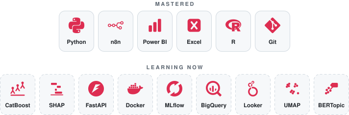
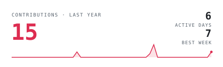

<picture>
  <source media="(prefers-color-scheme: dark)" srcset="art/header-dark.svg">
  
</picture>

<table align="center">
<tr>
<td width="62%" valign="top">

- 🎓 Finance BSc behind me; now on the MSc International Business honours track across **Maastricht, Stellenbosch &amp; Aston**.
- 🧬 Building the business-intelligence layer at **Qorium**, a biotech growing real leather in a lab.
- 🛠️ Built a fraud-detection model on **280,000+ transactions**, with a Power BI risk dashboard on top.
- 🏆 **Junction Hackathon runner-up** out of 120+ teams: automated ESG scoring for SME lending.
- 🥊 Off-screen: Hyrox, boxing, live-coded music, memory sport, learning Japanese and the FX markets.

</td>
<td width="38%" align="center" valign="middle">

</td>
</tr>
</table>

  

<!-- PROJECTS:START -->

<samp><b>hobby &amp; business</b></samp>

**t9-trading-floor** &nbsp;·&nbsp; <samp>typescript</samp> &nbsp;·&nbsp; <samp>private</samp>

**kaizena** &nbsp;·&nbsp; <samp>html</samp> &nbsp;·&nbsp; <samp>private</samp>

**petrakov-folio** &nbsp;·&nbsp; <samp>javascript</samp> &nbsp;·&nbsp; <samp>private</samp>

<samp><b>quant finance</b></samp>

**[portfolio-recommendation-engine](https://github.com/Petraisalex/portfolio-recommendation-engine)** &nbsp;·&nbsp; <samp>python</samp>  
Digital Business Analysis Project; Solving a digital problem through a digital analysis and sulution

<samp><b>business intelligence &amp; ml</b></samp>

**modastera-outbound-pipeline** &nbsp;·&nbsp; <samp>html</samp> &nbsp;·&nbsp; <samp>private</samp>

**blog-chart-spec** &nbsp;·&nbsp; <samp>python</samp> &nbsp;·&nbsp; <samp>private</samp>

<!-- PROJECTS:END -->

  
  

  

  
  &nbsp;
  
  &nbsp;
  

Collecting the next hobby. See you in the next commit.

