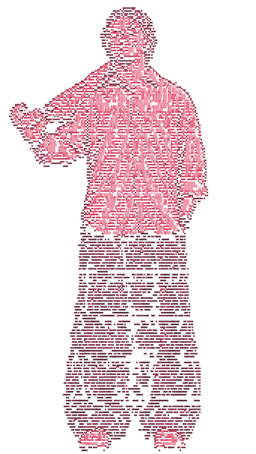
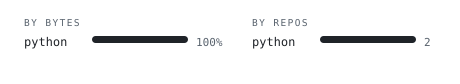
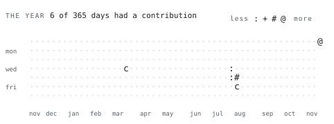

  

  

<a href="https://www.linkedin.com/in/alexander-petrakov-457291208/">linkedin</a>
&nbsp;&nbsp;·&nbsp;&nbsp;
<a href="https://www.instagram.com/petraisalex/">instagram</a>

 

> First-Class Finance graduate; incoming International Business MSc across Maastricht, Stellenbosch &amp; Aston.
> Financial engineering — where markets meet machine learning.

I build at the intersection of finance and AI: financial modeling, econometrics, data analytics, and machine learning, aimed at **wealth management, FP&A, and corporate development**. I turn messy problems into decisions, and translate fluently between technical and business stakeholders across international hubs.

<samp>python&nbsp; · &nbsp;sql&nbsp; · &nbsp;r&nbsp; · &nbsp;pandas&nbsp; · &nbsp;scikit-learn&nbsp; · &nbsp;excel&nbsp; · &nbsp;power bi&nbsp; · &nbsp;stata&nbsp; · &nbsp;javascript&nbsp; · &nbsp;git</samp>

<!-- PROJECTS:START -->

<samp><b>hobby &amp; business</b></samp>

**t9-trading-floor** &nbsp;·&nbsp; <samp>typescript</samp> &nbsp;·&nbsp; <samp>private</samp>

**kaizena** &nbsp;·&nbsp; <samp>html</samp> &nbsp;·&nbsp; <samp>private</samp>

**petrakov-folio** &nbsp;·&nbsp; <samp>javascript</samp> &nbsp;·&nbsp; <samp>private</samp>

<samp><b>quant finance</b></samp>

**[portfolio-recommendation-engine](https://github.com/Petraisalex/portfolio-recommendation-engine)** &nbsp;·&nbsp; <samp>python</samp>  
Digital Business Analysis Project; Solving a digital problem through a digital analysis and sulution

<samp><b>business intelligence &amp; ml</b></samp>

**modastera-outbound-pipeline** &nbsp;·&nbsp; <samp>html</samp> &nbsp;·&nbsp; <samp>private</samp>

**blog-chart-spec** &nbsp;·&nbsp; <samp>python</samp> &nbsp;·&nbsp; <samp>private</samp>

<!-- PROJECTS:END -->

 

 

Every graphic here is generated inside this repo — nothing is embedded from a third-party server, so nothing here can rate-limit or go dark.

`portrait.svg` is a photo pushed through a 13-character brightness ramp by `scripts/portrait.py`. The stat graphics and these section headings are drawn by [a scheduled action](.github/workflows/refresh.yml) straight from the GitHub GraphQL API, once a day, committing only what changed.

Everything is drawn to read correctly as a static image: GitHub renders README graphics as static (it runs no scripts or animation inside them), so nothing here depends on either. The headings are images too — GitHub strips CSS from README text, so an image is the only way to give them their own typeface.

The projects list is grouped by each repo's GitHub topic and rebuilt by `scripts/projects.py` in the same daily run; private repos appear by name only.

Language totals cover public repositories only. `year.svg` uses the portrait's own ramp — `:` `+` `#` `@`, quiet to loud.
